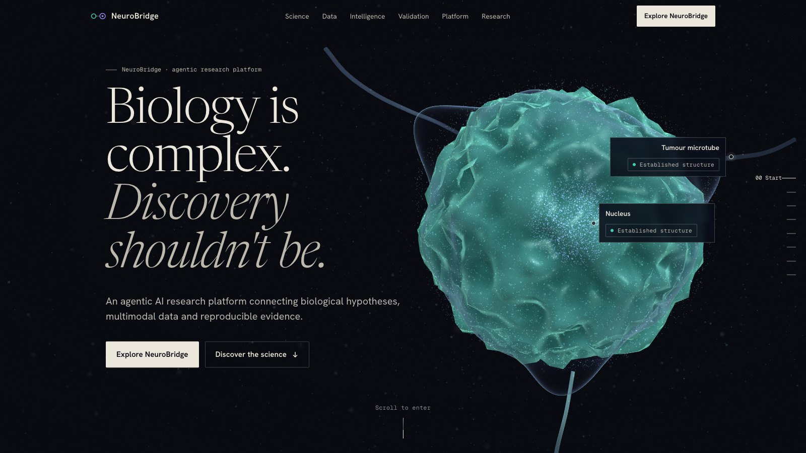
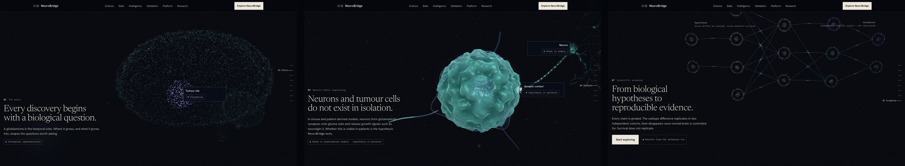
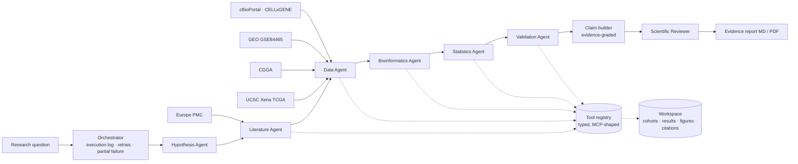

# NeuroBridge

**From biological hypotheses to clinically relevant evidence.**





*The NeuroBridge website (`site/`): a scroll-driven WebGL journey from the brain to a glioblastoma cell to the evidence.*

NeuroBridge is an agentic research platform for multimodal biomedical discovery. It is built around one question in glioblastoma:

> Can neuronal activity-related molecular signatures identify distinct glioblastoma subgroups, reveal neuron–tumour interactions and explain differences in patient outcomes?

You type a research question. Seven specialised agents then turn it into testable hypotheses, select public cohorts, run real statistical and single-cell analyses, and test replication in independent cohorts. They finish with an evidence report in which every claim is graded and linked to the analysis or paper behind it.

It is not a chatbot. No number in the app is generated by a language model. Every statistic comes from code that ran on public data during the session.

> Research exploration only. NeuroBridge does not make diagnostic or treatment recommendations.

---

## Why this problem

Glioblastoma is the most common malignant primary brain tumour in adults, with median survival of about 15 months. Over the last decade, experimental work has shown that **neurons talk to glioma cells**:
- Activity-regulated secretion of neuroligin-3 (NLGN3) drives glioma proliferation.
- Glioma cells receive bona fide AMPA-receptor synapses.
- BDNF–TrkB signalling strengthens those synapses.
- In patients, tumour–circuit connectivity has been associated with shorter survival.

A pharmaceutical R&D team would want to know whether this biology is visible in patient molecular data. Does it define patient subgroups? Does it track outcome? Does it replicate? Or is it confounded by how much normal brain ended up in the sample?

Answering that needs four things:
- Several data modalities: bulk RNA-seq, single-cell RNA-seq and clinical survival data.
- Rigorous statistics: effect sizes, multiple-testing control, confounder adjustment and assumption checks.
- Independent validation.
- An honest account of what the evidence can and cannot support.

NeuroBridge automates that workflow transparently.

## What the demo investigation finds

These numbers come from the reference run on the public data. The repository reproduces them with `make demo`.

| Question | Result | Evidence level |
|---|---|---|
| Does the 6-gene candidate score (NLGN3, SLC17A7, GRIA1, GRIA2, GRIN2B, BDNF) differ across subtypes in TCGA? | Yes. Proneural is highest and Mesenchymal lowest. Kruskal-Wallis p = 9.6e-4. Mesenchymal vs Proneural Hedges g = −0.92, BH q = 0.001. | Association (exploratory) |
| Does the Mesenchymal < Proneural difference replicate in independent cohorts? | **Replicated in 2/2 CGGA cohorts** using subtype labels projected by a TCGA-trained classifier, in IDH-wildtype tumours. g = −1.19 in CGGA-325 (p = 0.009) and −1.17 in CGGA-693 (p = 1e-5). | Association (confirmatory) |
| Is that difference independent of normal-brain content? | **No.** The score correlates with mature-neuron markers (Spearman rho 0.67–0.81). After residualising on them the difference does not replicate (g = −0.52, −0.38, +0.07). | Insufficient |
| Is the score associated with overall survival (adjusted Cox)? | **Not replicated.** TCGA HR/SD 1.16 (p = 0.14), CGGA-325 0.75 (p = 0.03, opposite direction), CGGA-693 0.95 (p = 0.59). I² = 72%. | Insufficient |
| Which cells express the candidate genes? | Mostly OPCs, neurons and astrocytes. In neoplastic cells GRIA1 is enriched relative to other cells. SLC17A7 (VGLUT1) is not detected in neoplastic cells. | Association (exploratory) |
| Where are they in intact tissue? (one Visium section) | Presynaptic SLC17A7 and GRIN2B follow neuron-rich tissue. Postsynaptic NLGN3, GRIA1 and GRIA2 are spread through tumour regions (composite score vs neuron programme rho = 0.05). GAP43 and NTRK2 rise and THBS1 falls near neuron-rich tissue, even after adjusting for each spot's neuron content. VGLUT1→GRIN2B/GRIA2, BDNF→NTRK2 and THBS1→CACNA2D1 co-localise beyond shared tissue domains; NLGN3→NRXN1 does not. | Association (exploratory, single patient) |

**Bottom line.** A neuronal-activity transcriptional axis reproducibly separates Proneural from Mesenchymal glioblastoma, but in bulk tissue it is not separable from normal-brain content, and it does not robustly predict survival.

The spatial section adds a nuance the bulk data cannot provide. The receptor side of the pathway sits in tumour tissue, independent of neuronal content, which is what tumour-intrinsic expression would look like. It is one patient, so it is a lead, not a finding.

That is a useful negative result. It tells a drug-discovery team that bulk transcript signatures are the wrong readout for neuron–glioma coupling. Deconvolution, spatial or functional readouts are needed. The platform reaches that conclusion by itself and states the evidence ceiling of the design: *statistical association*, never mechanism or causation.

## The five modules

| Module | What it does |
|---|---|
| **A · Research Copilot** | Question in, evidence out. Shows live progress through each agent and every tool call. You can inspect the plan, the agents' inputs, actions, outputs and limitations, the execution log, the figures, the literature and the reviewer's audit. |
| **B · Dataset Explorer** | Catalogue of public GBM resources with identifier, source, publication, n, modalities, clinical variables, preprocessing, ingestion status and known limitations. It also queries cBioPortal and CELLxGENE live. |
| **C · Biological Explorer** | Interactive gene and pathway analyses. Covers expression by subgroup, subtype comparisons, correlation matrices, volcano plots, ORA and GSEA, single-cell UMAP and dot plots, neoplastic-vs-other tests, ligand–receptor co-expression, and spatial maps on the H&E image with domain, gradient and co-localisation statistics. |
| **D · Validation Lab** | KM and Cox models with confounder selection and Schoenfeld PH tests, cross-cohort replication with a stated rule, sensitivity analyses, missing-data and power audit, and a reproducibility panel. |
| **E · Evidence Report** | A 13-section report with evidence tags, figures, tables and verified references. Exports to Markdown and PDF. |

## Architecture



- **Transparent orchestration, no agent framework.** The orchestrator runs agents in dependency order. Each agent decides which tools to call from the plan and from what earlier agents produced, and adapts when inputs are missing.
- **Typed tools.** There are 17 tools, each with a pydantic input schema. The registry exports a manifest in the [Model Context Protocol](https://modelcontextprotocol.io) tool shape, so the same skills can be served over MCP or handed to an LLM tool-use loop.
- **Executor.** It validates inputs, retries transient failures (network, downloads), records every call with timing and status, and never raises into the agent. A failed dataset is reported with its consequence and is never replaced by simulated data.
- **Typed results with provenance.** Every analysis returns an `AnalysisRecord` holding the method, parameters, seed, software versions, timestamps, n used and excluded, limitations and warnings.
- **Claims from templates.** Claims are generated from executed results with fixed templates, so every number in the report was computed. Each claim has an evidence level (plausibility, association, mechanistic or causal, insufficient) and a type (exploratory, confirmatory, sensitivity, literature or interpretation).
- **Rule-based reviewer.** It flags causal verbs in observational claims, literature claims without verified citations, single-cohort "validation", composition confounding, PH violations, pseudoreplication and failed tools.
- **Optional LLM.** Set `NEUROBRIDGE_LLM_PROVIDER=anthropic` and `ANTHROPIC_API_KEY` in `.env` to use Claude (Opus 5.5) for question decomposition and a reviewer narrative. Outputs are schema-validated with structured outputs, intersected with allowed values, and never used for numbers. Without a key, everything runs deterministically. Both paths are tested.
- **Question-aware analysis.** Genes named in the question are analysed as their own panel and individually. Population restrictions such as "IDH-wildtype" are applied to survival and validation analyses.

See [docs/ARCHITECTURE.md](docs/ARCHITECTURE.md).

## Data sources

All data are public. No synthetic patient data are used in the app. Unit tests use clearly labelled simulated data with known ground truth.

| Dataset | Modality | n | Role |
|---|---|---|---|
| TCGA-GBM RNA-seq (UCSC Xena HiSeqV2) | bulk RNA-seq, clinical, survival, Verhaak subtypes | 172 samples (154 primary) | discovery |
| CGGA mRNAseq_325, GBM subset | bulk RNA-seq, IDH, MGMT, survival | 139 (85 primary) | validation |
| CGGA mRNAseq_693, GBM subset | bulk RNA-seq, IDH, MGMT, survival | 249 (140 primary) | validation |
| GEO GSE84465 (Darmanis et al. 2017) | Smart-seq2 scRNA-seq, 4 patients, core vs periphery | 3,589 cells | cell-type reference |
| 10x Visium Human Glioblastoma (10x Genomics, CC BY 4.0) | spatial transcriptomics, 1 section, 1 patient | 3,468 spots | spatial reference |
| TCGA-GBM U133A array (Xena) | expression array, survival | 539 | platform check only (same patients as TCGA RNA-seq, never used as validation) |
| cBioPortal, CELLxGENE | live listings via public APIs | — | discovery of further datasets |
| Europe PMC | literature | — | verified citations |

Every downloaded file is recorded in a manifest with its URL, SHA-256, size and timestamp. Details, exact URLs and caveats are in [docs/DATA_SOURCES.md](docs/DATA_SOURCES.md).

**Not implemented, and why.**
- **Multi-patient spatial data.** The Ravi et al. 2022 Visium cohort is a multi-GB archive. Spatial results therefore come from one section and are descriptive.
- **Neftel 2019 and the large CELLxGENE atlases.** These are 1–7 GB and are listed with live metadata but not ingested.
- **Gravendeel GSE16011.** Survival data is not deposited in GEO.

## Analytical methods

| Step | Method |
|---|---|
| Signature score | mean per-gene z-score within cohort; rank-based alternative |
| Group comparison | Kruskal-Wallis with ε²; pairwise Mann-Whitney with BH correction; Hedges' g with 95% CI; Cliff's δ |
| Differential expression | Welch t-test per expressed gene; BH FDR; Hedges' g |
| Enrichment | hypergeometric ORA with the *measured-gene background*; pre-ranked GSEA (GSEApy) on Hedges' g |
| Survival | Kaplan–Meier with Greenwood CI and log-rank test; Cox PH (lifelines) with per-SD HR; confounders age, sex, IDH/G-CIMP and MGMT; scaled Schoenfeld PH test; events-per-variable check |
| Subtype transfer | L2 multinomial logistic regression trained on TCGA only, with candidate and neuron-marker genes **excluded from features**; within-cohort z-scoring; 5-fold CV (balanced accuracy 0.82) |
| Validation rule | replicated = same direction as discovery and p < 0.05 in an *independent* cohort; DerSimonian–Laird pooling with I² is descriptive only |
| Composition control | mature-neuron marker score as covariate and for residualisation |
| Single cell | Scanpy QC, normalisation, HVG, PCA, UMAP, Leiden; Wilcoxon with BH; permutation-based ligand–receptor scores |
| Spatial | spot QC and Leiden domains; programme scores; Moran's I on the hexagonal grid; gradient with ring distance from neuron-rich spots, partialled on each spot's neuron score; ligand–receptor neighbour co-localisation against a domain-stratified permutation null |

Full rationale, assumptions and the exploratory/confirmatory separation are in [docs/METHODOLOGY.md](docs/METHODOLOGY.md).

## Reproducibility

- **Run folders.** Each investigation writes `data/runs/<id>/`, containing `investigation.json` (plan, log, claims, review and serialised results), `figures/*.json`, `tables/*.csv`, `report.md` and `reproducibility.json` (software versions, seed and the data manifest with SHA-256 hashes).
- **Seed.** One seed, `NEUROBRIDGE_SEED`, drives every stochastic step: GSEA permutations, UMAP, Leiden, CV folds and ligand–receptor permutations.
- **Offline runs.** `NEUROBRIDGE_ALLOW_NETWORK=false` runs fully offline on cached data. Literature queries then fail loudly instead of returning invented records.

## Installation

```bash
git clone <this repo> && cd neurobridge
conda create -n neurobridge python=3.11 -y && conda activate neurobridge
pip install -e ".[llm,dev]"
cp .env.example .env            # optional: set NEUROBRIDGE_LLM_PROVIDER=anthropic
python scripts/fetch_data.py    # ~170 MB of public data, cached under data/cache/
streamlit run app/streamlit_app.py
```

Command-line demo: `python scripts/run_demo.py`. It prints agent progress and writes the report as Markdown and PDF.
Tests: `pytest`. That runs 39 tests: unit, data-validation on the real files, and offline end-to-end integration. Use `pytest -m "not slow"` to skip the full investigation.

## Repository layout

```
neurobridge/
  agents/        orchestrator, agents, planner, claim builder, reviewer, executor, tool registry, LLM adapter
  analysis/      signatures, groups, differential, enrichment, survival, validation, subtyping, sensitivity, singlecell, communication, spatial
  data/          catalogue, download cache + manifest, Xena / CGGA / GEO / 10x Visium / cBioPortal / CELLxGENE clients, harmonised Cohort
  knowledge/     candidate gene panels with rationale, Enrichr gene-set libraries
  literature/    Europe PMC client, curated key references (PMIDs only)
  report/        Markdown builder, PDF export
  viz/           Plotly theme (validated palette, dark mode) and figure builders with methods captions
app/             Streamlit UI: streamlit_app.py (navigation), views/ (overview, five modules, architecture), ui/ (shared components)
tests/           pytest suite
docs/            architecture, methodology, data sources
scripts/         fetch_data.py, run_demo.py
```

## Limitations

- **Bulk confounding.** Neuronal transcripts in bulk tissue mix tumour-intrinsic programmes with infiltrated normal brain. NeuroBridge measures this but cannot fully remove it.
- **Projected subtypes.** CGGA subtypes come from a classifier and carry its error.
- **Different adjustment sets.** Covariates differ across cohorts: G-CIMP in TCGA, IDH and MGMT in CGGA. Extent of resection and performance status are unavailable everywhere.
- **Small single-cell and spatial references.** The single-cell data have four patients and 21 neurons, and tests treat cells as replicates. The spatial data are one section from one patient, at 55 µm spot resolution.
- **Ceiling of the design.** No perturbation, spatial or longitudinal data means no mechanistic or causal claims.
- **Simple planner.** The deterministic planner uses keywords. The LLM planner is optional and constrained to the available workflows.

## Future developments

- Bulk deconvolution against a GBM single-cell reference, to separate malignant OPC/NPC-like signal from normal neurons.
- Multi-patient spatial cohorts (Ravi et al. 2022) and single-cell-resolution spatial data (Xenium/MERFISH), to test the spatial observations across patients.
- Larger single-cell atlases (CELLxGENE Census streaming) with patient-level pseudobulk tests.
- An MCP server exposing the tool registry, and LLM-driven tool selection over the same typed tools.
- Additional cohorts (CPTAC-GBM proteomics, GLASS longitudinal) and drug–target links (ChEMBL, Open Targets) for candidate genes.

## Website

`site/` contains the public website: an immersive WebGL journey from the brain to a glioblastoma cell to the evidence, followed by the real data, agents, validation results and platform screenshots. See [site/README.md](site/README.md) for how it is built and deployed. The research application stays in `app/`.

---
Built by Stefania Zoi (computational neuroscience PhD; biomedical engineering, ML, statistical modelling). Licence: MIT.
