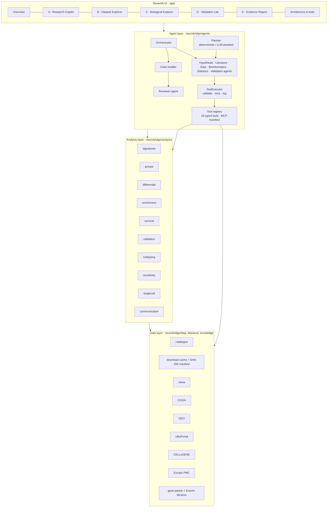

# Architecture

## Layers



The UI calls the agent layer for investigations and the analysis layer directly for interactive exploration. Both paths use the same functions.

## Execution model

1. The **orchestrator** creates an `Investigation` with an `ExecutionLog`, a `Workspace` (the artefact store) and a `ToolExecutor`.
2. **Agents** run in dependency order: Hypothesis, Literature, Data, Bioinformatics, Statistics, Validation. Each `Agent.run()` returns an `AgentMessage` holding inputs, actions, outputs, limitations and a status of succeeded, degraded or failed.
3. **Agents decide.**
   - The Hypothesis Agent chooses workflows from the question.
   - The Data Agent loads only the datasets the plan needs. It records unavailable datasets together with their consequence.
   - The Bioinformatics Agent switches panels when the question names genes.
   - The Validation Agent skips replication when no independent cohort loaded, and says so.
4. **Tools** are called only through the executor:
   - It validates input against the tool's pydantic model.
   - It retries `TransientToolError`, download and connection errors with backoff when the tool is retryable.
   - It records a `ToolCall` with inputs, status, attempts, duration, summary, output refs, error and limitations.
   - It never raises into the agent. A failed call returns `None`, and the agent degrades.
5. The **claim builder** turns tool outputs into claims using fixed templates.
6. The **reviewer** applies rules and optionally adds an LLM narrative constrained to those claims.
7. The **report builder** renders Markdown.
8. The **orchestrator persists** the run folder.

Partial failure is first-class. Integration tests break a cohort loader on purpose. The run then completes with status `completed with failures` and lists the dataset under `datasets_unavailable`. No simulated substitute is used.

## Tool contract

```python
@register("perform_survival_analysis", "<description>", SurvivalInput, category="statistics")
def perform_survival_analysis(ws: Workspace, inp: SurvivalInput) -> ToolOutput: ...
```

`ToolOutput` carries:
- a one-line `summary`;
- `refs` to workspace artefacts, which are typed results with an `AnalysisRecord`;
- `figures` and `tables` ids;
- `limitations`;
- a `degraded` flag;
- a small JSON `data` payload for downstream agents.

`REGISTRY.mcp_manifest()` emits `{name, description, inputSchema}` for each tool. That is the shape an MCP server or an LLM tool-use loop expects. To add a skill, write a function and decorate it. Neither the orchestrator nor the UI needs to change.

## Typed schemas (`neurobridge/schemas`)

- `DatasetRecord`: identifier, source, publication, n, modalities, clinical variables, access, ingestion status, preprocessing, limitations, demo flag.
- `AnalysisRecord`: provenance attached to every result.
- `DEResult`, `EnrichmentResult`, `GroupComparisonResult`, `CorrelationResult`, `KMResult`, `CoxResult`, `ValidationSummary`: typed results.
- `ResearchPlan`, `ToolCall`, `AgentMessage`, `ExecutionLog`, `InvestigationResult`: agent I/O.
- `Citation` (with a `verified` flag), `EvidenceLevel`, `Claim`.

## LLM integration

`neurobridge/agents/llm.py` wraps the Anthropic SDK (`messages.parse` with a pydantic output schema). It is used in exactly two places:
- **Planner.** It drafts sub-questions, hypotheses and literature queries. Workflows are intersected with the allowed set, and genes are validated against the expression matrix.
- **Reviewer narrative.** It receives only the computed claims and issues, and is instructed not to introduce numbers or citations.

Any failure, whether no key, rate limit, refusal or a parse error, falls back to deterministic behaviour and is logged as a limitation. The provider is chosen by `NEUROBRIDGE_LLM_PROVIDER`. A new provider only needs to implement `structured()`.

## Persistence

`data/runs/<id>/` contains:
- `investigation.json`
- `figures/<id>.json` (Plotly)
- `tables/<id>.csv`
- `report.md`
- `reproducibility.json`
- `export/`, with PNG figures, `report.md` and `report.pdf`

`neurobridge.runs.load_run()` rebuilds a run for the report page without re-executing it.

## Deployment path

The UI is stateless apart from Streamlit session state, and all heavy objects are cached. To deploy:
- Containerise with the cached `data/cache/` volume.
- Set `NEUROBRIDGE_ALLOW_NETWORK` as policy requires.
- Move the orchestrator behind a job queue (each investigation is a pure function of question, options and data manifest).
- Expose the tool registry through an MCP server for use by other agents.
